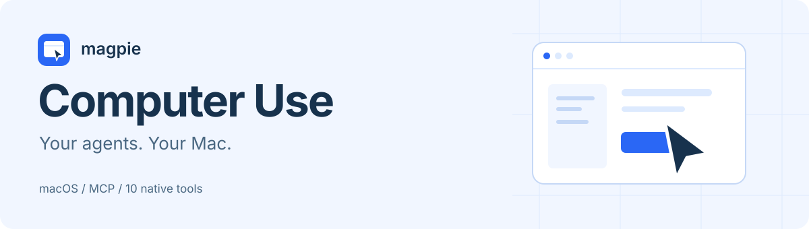

  

  <b>让你常用的 Agent 操作本机 macOS 应用。</b> 
  从 magpie 安装一次，向所选 Agent 分发十个 Computer Use 工具。

  <a href="#开始使用">开始使用</a> ·
  <a href="docs/USAGE.md">使用指南</a> ·
  <a href="docs/ARCHITECTURE.md">工作原理</a> ·
  <a href="docs/TROUBLESHOOTING.md">故障排查</a>

## 你的 Agent，多一双手

读取应用界面、查看截图、点击按钮、输入文字、滚动与拖动。插件自动识别本机完整的 Codex 桌面安装，使用其原始 Computer Use 组件；通过标准 MCP，把这些操作交给你在 magpie 中选择的 Agent。

| 安装一次 | 自动发现 | 原生授权 |
| --- | --- | --- |
| 自动加入 magpie 资源库，按需分发给 Agent | 不用填写 Codex 路径，没有独立设置页 | 沿用本机 Codex 的持久应用批准，新请求仍由用户决定 |

**适用环境：** Apple Silicon Mac、magpie，以及包含完整 Computer Use 组件且签名有效的官方 Codex 桌面应用。部分安装名为 `ChatGPT.app`，完整的重命名安装也可识别。普通使用不需要另装 Node 或 LCU。

## 开始使用

1. 在 magpie **扩展 → 插件** 添加 `github:wbb6517/magpie-computer-use` 并启用。
2. 打开 **资源库 → MCP 服务器 → magpie-computer-use**，选择需要使用的 Agent。
3. 检测工具，确认列出十个操作，再重连 Agent 或新开会话。
4. 让 Agent 先发现应用，再读取目标界面，最后执行操作。

例如：

> 列出当前可用应用。打开一个空白测试文稿，读取界面，然后输入「Hello from magpie」。

首次访问目标应用时，按原始授权提示确认。能否展示截图或完成新的授权询问，取决于所选 Agent 的 MCP 支持。

当前开发版本为 **0.5.0**，尚未发布到 npm。发布后也可在同一扩展界面按包名 `magpie-computer-use` 添加；无需克隆仓库或执行插件安装命令。

## 十个工具

| 工具 | 能做什么 |
| --- | --- |
| `list_apps` | 发现本机应用 |
| `get_app_state` | 获取目标界面树和截图，触发必要的原始授权 |
| `click` | 按元素索引或截图坐标点击 |
| `perform_secondary_action` | 执行界面列出的辅助操作 |
| `set_value` | 修改可编辑元素的值 |
| `select_text` | 选中文字或放置光标 |
| `scroll` | 滚动指定元素 |
| `drag` | 按截图坐标拖动 |
| `press_key` | 发送按键或组合键 |
| `type_text` | 输入文字 |

操作前读取 `get_app_state`，保持同一 `app` 标识，并使用最新的元素索引。点击等操作返回新的界面树，需要新截图时再读取状态。详见[完整参数与示例](docs/USAGE.md#十个工具的参数)。

## 授权留在本机

插件调用原始运行时，由它识别 Codex **Always-allowed apps** 中的持久批准。新应用仍通过原始 MCP 询问用户；其他会话的临时允许不会自动借用。插件不读取登录 token、钥匙串或账号凭据，也不维护另一份应用批准清单。

macOS 辅助功能、屏幕录制及原生进程认证仍按官方流程处理。模型和账号继续在 magpie 中选择；本插件只提供本机操作工具。

## 更新与移除

更新扩展或 Codex 后，重新检测并重连 MCP。0.4 的精确旧条目可以保留 Agent 选择；旧 `--config` 参数只兼容命令格式，其选项文件不再读取。

**在 magpie 中移除插件后，会自动清理本插件登记的 MCP，并由 magpie 同步撤销 Agent 分发。** 普通宿主退出、关闭开关和版本更新不会触发删除；同名自定义 MCP 也不会被清理。实现与适用边界见[停用与移除](docs/USAGE.md#停用与移除)。

卸载不会撤销 Codex 的持久应用批准或 macOS 权限；需要调整时，在对应原生界面管理。

## 已验证到哪一步

当前版本已验证自动登记、十工具发现、安装发现与原始只读应用发现。卸载清理另做隔离生命周期验收，详见[验证记录](docs/VERIFICATION.md)。0.4 的 GUI 截图保留为历史记录，不能替代新版 GUI 控制或持久批准复用的端到端验证。

浏览器组件初始化成功也不等于已有可用浏览器会话；本轮只读检测返回零个浏览器，没有验证接管其他聊天的浏览器连接。

## 开发与来源

[贡献指南](CONTRIBUTING.md) · [变更记录](CHANGELOG.md) · [发布说明](docs/PUBLISHING.md) · [MIT 许可证](LICENSE)

必要 macOS 网关与共享客户端基于 [LCU 0.11.4](https://github.com/amontlabs/lcu) 适配，保留[第三方声明](THIRD_PARTY_NOTICES.md)、[网关来源](src/gateway/SOURCES.md)及[客户端修改记录](vendor/lcu-client/PATCHES.md)。插件不分发、下载、复制或修改 OpenAI 官方二进制。

本插件通过 `magpie.kind: "middleware"` 声明为中间件类型。

GitHub 仓库已设置 `magpie-plugin` topic。npm 发布、GitHub 发现与官方推荐是不同状态；推荐列表需另向 [magpie-community/plugins](https://github.com/magpie-community/plugins) 申请。图标通过官方 `magpie.icon` 字段提供，发布标准见 [magpie 插件文档](https://usemagpie.ai/docs/zh/plugins#publish)。
