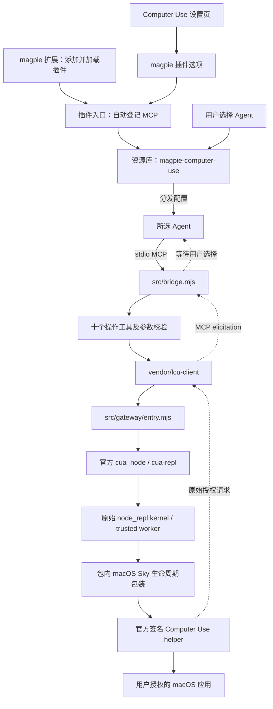
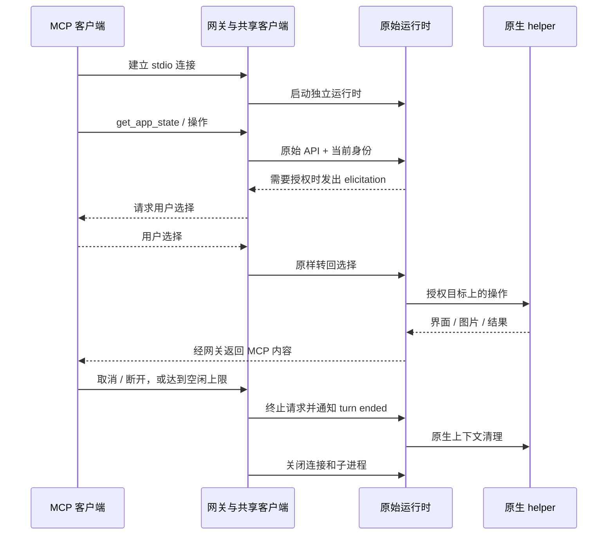

# 工作原理

magpie Computer Use 是一个 magpie 扩展。扩展加载时自动登记资源库 MCP；资源库负责由用户选择 Agent 并分发配置；包内网关把工具调用接到本机官方 ChatGPT 应用的完整 Computer Use 运行时。

MCP 是扩展向 Agent 传输工具、图片和授权询问的内部通路。正常安装入口只有 magpie“扩展”，用户无需手工注册 MCP 或编辑客户端配置。

## 从扩展到目标应用



### 1. 扩展加载与资源库登记

`index.mjs` 是 magpie 扩展入口。magpie 调用 `server(input, options)` 时，插件自动检查并登记资源库 MCP，用户在资源库选择目标 Agent。插件设置和工具通路分开：设置页通过 magpie 选项桥接读写选项，Agent 工具通过标准 MCP 传输，以保留原始图片及授权请求。

自动登记服务与启用 Agent 是两个动作。资源库条目的存在不意味着客户端已经连接，更不意味着已经授权控制某个应用。

`src/library.mjs` 负责资源库连接定义、同名条目检查、自动登记和私有选项快照。`input.directory` 是 magpie 配置目录；快照位于其下的 `plugins/magpie-computer-use/options.json`，以私有权限和临时文件原子替换写入。新条目的 Agent 选择为空，已有相同定义的用户选择与工具开关不被重写；旧版本定义或无关同名定义要求先在界面核对，避免静默覆盖。

`src/config.mjs` 负责选项校验、默认值、快照读取、官方运行时路径及基础状态。它不再解析安装 spec 来猜配置来源。设置页保存后由 magpie 重载插件，更新快照；已有 MCP 进程仍需重连。

资源库使用 magpie 管理的 Bun launcher 启动本包的 `bin/magpie-computer-use.mjs mcp --config <快照路径>`。连接入口保持稳定，选项变化通过快照传递，用户无需安装 Node 或编辑 MCP JSON。本地插件目录移动后仍需在扩展中更新来源。

### 2. 校验并启动原始运行时

MCP 服务入口由 magpie 的 Bun launcher 启动，再启动包内 `src/gateway/entry.mjs`。官方应用内的 `cua_node/bin/node` 用于执行原始 `@oai/cua-repl`。网关检查完整应用布局、必需文件、应用/helper 的 bundle identifier、OpenAI TeamIdentifier，以及 deep/strict 签名。

校验通过后，网关设置原始 Node、模块、可信服务和沙箱所需环境，启动包内 macOS lifetime host 与原始运行时。helper、Node、`node_repl` 和配套文件必须来自同一套完整官方安装。

官方应用、helper 和运行时文件留在原安装位置。插件不下载 LCU 发布包，不读取 `.runtime/lcu`，也不复制、修改或重新签名 OpenAI 二进制。

## 为什么内部是两个工具，对外是十个

原始 `cua-repl` MCP 提供 `js` / `js_reset` 两个脚本接口。插件默认把常用 macOS 操作包装成 `src/native-tools.mjs` 中的十个工具，使 Agent 直接按操作名称调用。

每个操作先校验参数，再生成固定的原始 `cua` API 调用。用户字符串和对象经 `JSON.stringify` 编码为数据，不直接拼接为任意可执行代码。

| 对外工具 | 内部原始 API |
| --- | --- |
| `list_apps` | `cua.listApps()` |
| `get_app_state` | `cua.getApp(app)`、`target.getScreenshot()` |
| `click` | `target.click(...)` |
| `perform_secondary_action` | `target.performSecondaryAction(...)` |
| `set_value` | `target.setValue(...)` |
| `select_text` | `target.selectText(...)` |
| `scroll` | `target.scroll(...)` |
| `drag` | `target.drag(...)` |
| `press_key` | `target.pressKey(...)` |
| `type_text` | `target.typeText(...)` |

`get_app_state` 按当前 session、turn 和 `app` 字符串的 SHA-256 哈希保存独立目标绑定。只有该工具声明绑定，其他操作直接引用，操作后调用 `getAXState()` 返回新界面树；需要新截图时再次调用 `get_app_state`。

原始 REPL 会在每个 cell 重新初始化其中声明的 `var`；重复声明共享 Map 会丢失前一个 cell 的应用对象。现实现避免在后续操作重新声明目标容器，回归 fixture 也模拟这种原始 REPL 行为。真实修复与工具验证结果见 [验证记录](VERIFICATION.md)。

内部仍保留显式 JavaScript 接口用于开发与兼容检查。它与十工具接口共用相同认证、授权与生命周期，不是另一种绕过系统限制的执行方式，也不是用户需要额外安装的产品。

## MCP 内容转发

`src/bridge.mjs` 使用 MCP SDK 创建 stdio 服务，共享客户端连接原始 MCP。十个工具被转换为固定的内部 `js` 调用。

文字、MCP image block、`isError` 和工具结果保留原始语义。宿主提供 progress token 时，原始进度通知关联到该 token 后转发。Agent 是否显示图片、进度和授权卡片取决于其能力，不能单凭协议支持认定已实测。

stdio 的标准输出用于 MCP 协议，诊断写入标准错误。共享客户端持续排空上游 stderr，仅为启动失败保留有界尾部，不把完整运行时日志和截图作为插件缓存。

## 三种不同的身份与权限

### 原生进程认证

原始 Sky/native transport 与官方签名 helper 执行原生进程/连接校验。本项目负责从完整、签名有效的官方安装启动其原始链路，并保留原有校验；它没有自行实现一套替代认证协议。

项目没有用户应填写的认证 token。`Sender process is not authenticated` 属于这一层的错误，不能用填充 `session_id`、手写 token 或自动批准应用解决。仅从包内 JavaScript 也不能推断官方组件全部认证细节。

### 上下文身份

宿主可通过 MCP 请求 `_meta['x-codex-turn-metadata']` 提供真实 `session_id`、`turn_id`，可附带 `call_id`。网关只读取宿主元数据，不接受模型工具参数冒充身份；元数据缺失时为当前连接创建独立上下文。

这些 ID 用于归属和清理，不是密码、系统权限或应用授权。没有宿主事件的通用 MCP 也不能推断真实聊天回合结束。普通工具调用完成后保留上下文，避免每一步都重新选择应用。

### 应用授权与系统权限

目标应用访问由原始运行时发起 elicitation。网关将请求交给当前 MCP 客户端，转回用户的 `accept`、`decline` 或 `cancel`。客户端未声明 elicitation 能力、请求取消或传输失败时取消该次授权。

已知 Agent 宿主、检测到的承载当前会话的应用，以及 magpie 本身被拒绝控制，防止 Agent 点击自己的授权界面。生产入口同时拒绝开启宿主控制旁路或关闭原始沙箱的环境设置。

macOS 辅助功能、屏幕录制等权限继续由系统管理。应用授权、macOS 权限、进程认证和登录状态不能相互替代。

## 生命周期与超时



- 每个下游 MCP 连接拥有独立客户端、运行时进程与上下文，不共享模型的 JavaScript 变量。
- 请求活动时间默认 120 秒；等待用户授权时暂停预算，客户端自身仍可取消。活动请求和待授权请求期间不触发空闲计时。
- 默认空闲 5 分钟后关闭连接。EOF、传输关闭、SIGINT、SIGTERM、启动失败也进入关闭流程。
- 单次请求取消或超时后，等待同上下文中的其他调用退出，再通知原始 `turn_ended`。连接级上下文清理成功后换用新的 turn identity；清理失败则关闭连接。
- `js_reset` 先处理旧 worker 已使用的回合，再重置 worker，保留清理能力。
- 包内 macOS lifetime host 跟随网关存活，维护打开的上下文，利用原始 `turn-ended` 通路补做原生清理。
- 失效服务恢复保留来源实现的进程归属、签名、socket 和锁检查，不按进程名字随意终止其他实例。

本项目保留的是可观察的连接和上下文生命周期，不承诺每个 MCP 客户端都提供聊天 Stop/Interrupt 事件。

## Chrome 边界

`chrome: true` 增加内部原始浏览器服务。包内没有浏览器安装器、浏览器扩展或独立 native-host relay。对应官方扩展、native host 及网站授权仍需原始支持。

当前扩展默认分发十个 macOS 操作工具。浏览器脚本属于内部高级接口，Chrome 开关不会增加新的对外操作，也不会自动安装浏览器组件。Chrome 未纳入本轮实测。

本轮十工具 GUI 已在自有 AppKit 测试应用执行；滚动方向存在已记录限制，不能由 `isError: false` 推断所有方向语义正常。具体结果见 [验证记录](VERIFICATION.md)。

## 目录

```text
magpie-computer-use/
├── index.mjs                    # magpie 扩展入口与自动登记
├── page/                        # 设置页、样式、图标和选项桥接
├── bin/magpie-computer-use.mjs   # 内部 MCP 与开发诊断入口
├── src/
│   ├── config.mjs               # 选项校验、快照读取、运行时路径与状态
│   ├── library.mjs              # 资源库定义、自动登记、冲突检查与快照写入
│   ├── cli.mjs                  # 内部服务与开发诊断命令
│   ├── bootstrap.mjs            # 官方运行时校验
│   ├── bridge.mjs               # MCP、授权、超时与清理
│   ├── native-tools.mjs         # 十工具 schema 和 API 映射
│   ├── process.mjs              # 有界子进程执行
│   └── gateway/                 # macOS 启动和生命周期
├── vendor/lcu-client/           # MIT 来源共享客户端与宿主保护
├── scripts/                     # 静态检查、只读 smoke、GUI 测试窗口
├── tests/                       # 隔离 fixture 和自动化测试
├── docs/                        # 使用、原理、故障与验证记录
├── THIRD_PARTY_NOTICES.md        # 第三方来源说明
└── LICENSE                      # 项目 MIT 许可证
```

## 来源、发布与验证

网关和共享客户端基于 LCU **0.11.4**，commit `bf45b8edf01bc380def2ba8355b60a4ab5e1857d`，MIT，Copyright (c) 2026 Amont Labs。保留必要的 macOS 启动与清理逻辑；外部安装器、发布包更新器、各 Agent 专用安装流程和未使用的控制支路不属于扩展正常使用流程。

具体文件和修改见 [网关来源](../src/gateway/SOURCES.md)、[客户端修改记录](../vendor/lcu-client/PATCHES.md)、[第三方声明](../THIRD_PARTY_NOTICES.md) 和所附许可证。OpenAI 二进制和原始运行时文档不由插件重新分发。

扩展当前尚未发布、尚未进入官方精选。后续 GitHub 发布可以设置 `magpie-plugin` topic 参与发现；精选收录需另外向 magpie-community/plugins 提交。当前没有自动卸载钩子，用户先在资源库取消分发并移除 MCP，再从扩展移除插件。来源分析、发布准备、工具发现和真实 GUI 验收是不同的证据，详细结果见 [验证记录](VERIFICATION.md)。
