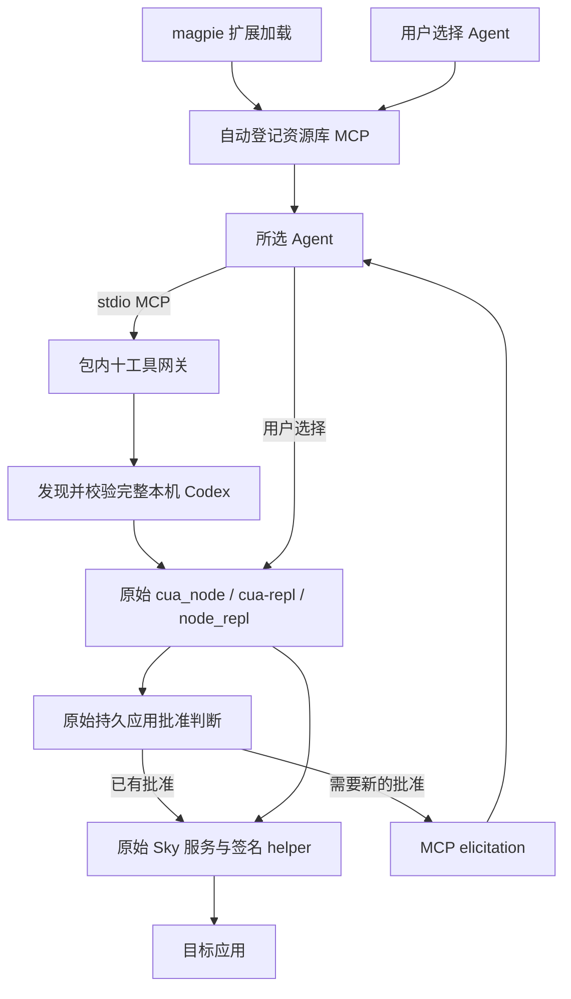

# 工作原理

0.5.0 是无独立设置页的 magpie 扩展。扩展自动登记资源库 MCP，用户选择 Agent；MCP 每次启动发现本机 Codex，调用其原始 Computer Use 组件并沿用原生账户批准。

## 按代码阅读的顺序

可以先按下面顺序看主路径，再看后面的授权与清理细节。源码中“工作流 ①—⑦”的注释对应这些阶段。

| 阶段 | 从哪个函数开始看 | 输入与结果 |
| --- | --- | --- |
| ① 扩展加载 | [index.mjs](../index.mjs) 的 `server()` → [library.mjs](../src/library.mjs) 的 `ensureLibraryMcp()` | 读取 magpie 资源库，必要时登记本包的启动命令；已有兼容条目保持原样。此时不启动控制运行时。 |
| ② Agent 连接 | [bin 入口](../bin/magpie-computer-use.mjs) → [cli.mjs](../src/cli.mjs) 的 `main()`，进入 `mcp` 分支 | Agent 启动资源库中的命令，建立本次 stdio 连接。 |
| ②a 发现与配置 | [config.mjs](../src/config.mjs) 的 `loadOptions()` → [codex-settings.mjs](../src/codex-settings.mjs) / [codex.mjs](../src/codex.mjs) | 取本机 Codex 的运行参数白名单、查找完整应用；随后 `requireRuntime()` 在可信 launcher 中校验官方签名。 |
| ③ 连接两端 MCP | [bridge.mjs](../src/bridge.mjs) 的 `runBridge()` | 先用内部 MCP Client 启动网关并发现原始 `js/js_reset`，再向 Agent 发布十工具的 MCP Server。 |
| ④ 转换操作 | [native-tools.mjs](../src/native-tools.mjs) 的 `nativeCall()` | 将工具名和参数校验、编码成固定的 `cua` API 脚本，由内部 `js` 工具执行。 |
| ⑤ 启动原始运行时 | [gateway/entry.mjs](../src/gateway/entry.mjs) 的 `main()` | 再次检查安装、组装原生环境、创建生命周期宿主，通过官方包内 Node 启动 `cua-repl`。这是③启动网关时发生的子进程流程。 |
| ⑥ 执行原生请求 | [macos_sky_service.mjs](../src/gateway/macos_sky_service.mjs) 的 `handleRpc()` | 包装器先处理待完成的清理，再调用官方 Sky 的 `handleRpc()`；实际应用访问策略、认证及系统操作仍由原始组件执行。 |
| ⑦ 结束与回收 | [bridge.mjs](../src/bridge.mjs) 的 `cleanup()/close()` → 原始结束钩子 → [macos_host.mjs](../src/gateway/macos_host.mjs) | 取消或退出时通知原始运行时结束对应上下文，回收本连接的 worker、子进程和私有生命周期 socket。 |

这里的编号用于定位源码。实际时间顺序是：①登记 → ②启动 → ③建立内部连接时进入⑤ → 发布十工具 → 每次调用经过④和⑥ → 需要时⑦清理。

### 跟一次“读取界面，再点击”

1. Agent 调用 `get_app_state({ app })`。`bridge` 取得当前连接或宿主轮次身份，`nativeCall` 生成 `cua.getApp(app)` 与截图调用。选中的目标保存在原始 REPL 中，绑定名包含 session、turn 和 app 的哈希。
2. 原始组件检查目标访问策略及已有持久批准。仍需询问时，请求经内部客户端回到 `bridge.elicit()`，再由当前 Agent 展示给用户；用户的选择沿同一路径返回。本包不读取批准清单自行放行。
3. Agent 获得界面与截图后，用最新的元素索引调用 `click({ app, element_index })`。包装器复用上一步的目标，执行 `target.click(...)`，随后读取新的界面树。需要新截图时再次调用 `get_app_state`。
4. 官方工具结果由客户端、桥接层原样传回 Agent：图片仍是 MCP image block，错误保留 `isError`。这一动作完成后仍保留目标上下文，后续动作可以继续使用同一连接。
5. Agent 取消调用、关闭连接，或触发内部超时/空闲退出时，桥接层进入对应的清理分支；不会把每次点击都误当成整个聊天轮次结束。

## 调用链



## 安装、发现与启动

`index.mjs` 的 magpie 生命周期入口调用 `src/library.mjs` 登记本包 MCP，保留已有 Agent 选择，拒绝覆盖同名无关定义。新定义由 magpie 管理的 launcher 启动本包 `mcp`，不持久化选项快照。

仅精确匹配本包 CLI 与旧私有快照位置的 0.4 命令格式可兼容保留；CLI 的 `--config` 不再读取文件。旧 magpie options 同样忽略。扩展加载负责登记，启动 MCP 才发现运行时和请求目标访问。

`src/codex.mjs` 按以下顺序发现完整应用：

1. `CODEX_CLI_PATH` 所在应用，或当前可执行文件所属的完整应用。CLI 路径优先使用当前进程正常继承的值，缺失时可取本机 Codex 的 `mcp_servers.node_repl.env`。
2. 正在运行的完整 Codex 应用。出现多份有效安装时报告歧义，不随意选择。
3. `/Applications`、当前账户 `~/Applications` 下的 `Codex.app`、`ChatGPT.app`。
4. Spotlight 查询 bundle identifier `com.openai.codex`，支持其他位置或重命名的 `.app`。

发现阶段核对应用身份元数据和必需组件。候选 Node 执行前，当前可信 launcher 先检查完整布局、组件没有被符号链接重定向、应用/helper 的 bundle identifier、OpenAI TeamIdentifier 和 deep/strict 签名。应用可重命名，但不是任意同名目录或复制出的 Node/helper。网关内也保留同样的检查，不让候选 Node 先执行后自验。每次 MCP 启动重新发现，避免更新后使用旧路径。

`src/config.mjs` 负责发现结果、原始组件可用性、运行时路径及内部预算。`src/codex-settings.mjs` 用 `smol-toml` 1.9.1 解析本机 Codex 的 `config.toml`，只从 `mcp_servers.node_repl.env` 提取白名单 backend/原生连接参数、发现用 `CODEX_CLI_PATH`，以及 `NODE_REPL_TRUSTED_SERVICES` 的 `browser` 项；sky 仍经过包内生命周期包装。当前进程正常继承的环境优先，不复制该配置段中的 per-session executor、验证 identity、登录凭据或 host pipe。

原始浏览器服务按组件可用性启用，没有单独的 Chrome 设置；这不保证扩展/native host、网站授权或浏览器会话可用。0.5 本轮 `cua.listBrowsers` 初始化返回 `isError: false`，但列表为 0，未验证浏览器操作或接管其他聊天连接。

## 十工具与原始脚本接口

`src/native-tools.mjs` 把十个独立操作映射为原始 `cua` API，参数先校验，再按 JSON 数据编码。内部 `js` / `js_reset` 是原始脚本接口，正常资源库对外默认仍为十个操作。

| 对外操作 | 原始调用 |
| --- | --- |
| `list_apps` | `cua.listApps()` |
| `get_app_state` | `cua.getApp()`、`getScreenshot()` |
| `click` | `click()` |
| `perform_secondary_action` | `performSecondaryAction()` |
| `set_value` | `setValue()` |
| `select_text` | `selectText()` |
| `scroll` | `scroll()` |
| `drag` | `drag()` |
| `press_key` | `pressKey()` |
| `type_text` | `typeText()` |

目标对象按 session、turn、app 的哈希保存在原始 REPL 绑定中，仅 `get_app_state` 声明绑定，后续操作直接引用，避免每个 cell 重新声明 `var` 清空共享容器。操作后读取新界面树，截图由 `get_app_state` 重新获取。

`src/bridge.mjs` 与共享客户端保留原始文字、MCP image block、错误和进度。stdio stdout 是协议，stderr 仅用于诊断；实际显示和授权交互取决于 Agent 能力。

## 沿用哪些授权

当前随应用提供的原始 `node_repl` 已核对以下路径：

- `ComputerUseElicitationInterceptor::maybe_auto_answer` 调用 `macos_approvals::contains/read` 判断持久应用批准。
- 原始授权结果经 `on_result` 进入 `persist`，由官方组件保存用户选择。
- macOS 存储位于当前账户的 `~/Library/Group Containers/2DC432GLL2.com.openai.sky.CUAService/Library/Application Support/Software/ComputerUseAppApprovals.json`，与桌面 **Always-allowed apps** 共用。

插件不实现另一套批准判定，不解析该清单来批准目标，不改写此文件或伪造 `accept`。复用发生在原始运行时内部；这里描述的是已核对版本的静态调用链，0.5 本轮未做持久批准端到端 GUI 验收，官方内部格式也可能随版本变化。

持久批准与会话临时授权不同。新的目标或仅在其他会话中临时允许的应用仍可能发出原始 elicitation，由当前 Agent 转交用户。缺少支持、取消或没有回答时取消该次询问。插件不读取 `auth.json`、钥匙串、账号 cookie 或登录 token。

应用批准也不替代辅助功能、屏幕录制等系统权限，或 helper 的原生进程认证。session/turn ID 只用于操作归属和清理，不是认证凭据。宿主保护和原始沙箱保持。

## 原生连接与会话边界

插件沿用原始 Sky 模块及 helper 连接。宿主正常传入 `SKY_CUA_SERVICE_NATIVE_PIPE_PATH` 时保留；否则使用官方当前账户的 `computeruse.sock`。`NODE_REPL_HOST_SERVICES_PIPE_PATH` 若由宿主传入也正常保留，不主动扫描或借用其他会话 pipe。

这不等于附着到任意已打开聊天的临时授权。每个 MCP 连接仍有自己的客户端、worker 和上下文。真实宿主元数据存在时传递 session/turn 身份，否则使用连接级身份；普通工具完成不被当作整轮聊天结束。

内部请求预算与空闲时间只管理本 MCP 连接，不能承诺与 Codex 每项行为完全一致。等待用户询问期间暂停活动预算；取消、超时、EOF、信号或空闲触发原始 turn-ended 和关闭清理。`js_reset` 在销毁旧 worker 前处理其上下文。失效服务恢复仍核对归属，不按名称批量结束正常服务。

## 目录

```text
magpie-computer-use/
├── index.mjs                    # magpie 生命周期入口
├── bin/magpie-computer-use.mjs   # 内部 MCP 与开发诊断
├── src/
│   ├── codex.mjs                # 本机完整 Codex 发现
│   ├── codex-settings.mjs       # 正式 TOML 解析与运行参数白名单
│   ├── config.mjs               # 运行时路径、组件与内部预算
│   ├── cleanup.mjs              # 安装记录监视、卸载撤销与同步重试
│   ├── library.mjs              # MCP 自动登记、移除与旧条目兼容
│   ├── cli.mjs                  # 内部服务及诊断入口
│   ├── bridge.mjs               # MCP、授权转发与清理
│   ├── native-tools.mjs         # 十工具参数及映射
│   └── gateway/                 # 原始运行时启动与 macOS 生命周期
├── vendor/lcu-client/           # MIT 来源客户端与宿主保护
├── scripts/                     # 检查、只读 smoke、自有 GUI fixture
├── tests/                       # 隔离测试
└── docs/                        # 使用说明与分版本验证记录
```

必要网关与共享客户端基于 LCU 0.11.4 的 MIT 来源适配，保留[来源声明](../THIRD_PARTY_NOTICES.md)、[网关修改](../src/gateway/SOURCES.md)和[客户端记录](../vendor/lcu-client/PATCHES.md)。OpenAI 二进制不复制进包。

[验证记录](VERIFICATION.md) 分别标注 0.5 当前结果与 0.4 历史实测；旧版设置页、快照与 GUI 结果不能替新版验收。

## 卸载后的资源清理

`index.mjs` 在自动登记之后调用 `src/cleanup.mjs`。当前 magpie 不提供插件卸载回调，卸载 npm 包时也跳过生命周期脚本，不能用 `uninstall` 脚本或宿主 `exit` 回调实现这一功能。普通 CLI 命令和宿主重启同样会退出，直接在退出时删除会误清理。

插件因此使用一个轻量独立进程监视配置目录中的 `plugins.json`，并以五秒轮询兜底。临时 Unix socket 保证同一 profile、同一入口只有一份监视进程，不安装系统服务或复制运行时。全部清理依赖在启动时静态载入，cwd 使用 magpie 配置目录；卸载删除包文件后仍可调用官方 CLI 完成同步。

只有结构有效的安装列表持续明确不含当前插件、经过宽限并再次核对后，才允许移除。本地路径按规范路径匹配，npm/Git 来源同时验证实际安装目标；版本变更和 `off:true` 仍算已安装。清理前精确核对原 MCP 的 command/argv，自定义替换不删除。执行过程中重新安装时恢复缺失登记，按新安装从未分发状态开始；宽限内重装则取消清理，保留原选择。

删除调用 `magpie library mcp rm`，不自行改写各 Agent 配置。CLI 返回 0 不足以证明分发撤销成功；`library.json.applied[].mcp` 和 `projects[].wrote[]` 的持有账本仍包含本名时，继续用 `magpie library sync` 重试。独立的 `applied.json` 属于模型/网关接管记录，不用于此判断。

当前宿主依据：[magpie 卸载流程](https://github.com/yetone/magpie/blob/d783df46cbac9021e26a6bd71ca0b55544552eb2/internal/plugin/store.go#L561)、[宿主停止](https://github.com/yetone/magpie/blob/d783df46cbac9021e26a6bd71ca0b55544552eb2/internal/plugin/host.go#L759)。此方式依赖插件加载后监视进程仍在运行，不承诺系统重启后从未加载插件便离线卸载的清理；恢复方法见[使用指南](USAGE.md#停用与移除)。
