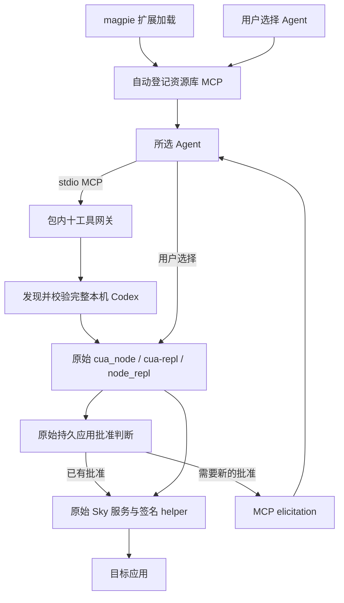

# 工作原理

0.5.0 是无独立设置页的 magpie 扩展。扩展自动登记资源库 MCP，用户选择 Agent；MCP 每次启动发现本机 Codex，调用其原始 Computer Use 组件并沿用原生账户批准。

## 调用链



## 安装、发现与启动

`index.mjs` 的 magpie 生命周期入口调用 `src/library.mjs` 登记本包 MCP，保留已有 Agent 选择，拒绝覆盖同名无关定义。新定义由 magpie 管理的 launcher 启动本包 `mcp`，不持久化选项快照。

仅精确匹配本包 CLI 与旧私有快照位置的 0.4 命令格式可兼容保留；CLI 的 `--config` 不再读取文件。旧 magpie options 同样忽略。扩展加载负责登记，启动 MCP 才发现运行时和请求目标访问。

`src/codex.mjs` 按以下顺序发现完整应用：

1. `CODEX_CLI_PATH` 所在应用，或当前可执行文件所属的完整应用。CLI 路径优先使用当前进程正常继承的值，缺失时可取本机 Codex 的 `mcp_servers.node_repl.env`。
2. 正在运行的完整 Codex 应用。出现多份有效安装时报告歧义，不随意选择。
3. `/Applications`、当前账户 `~/Applications` 下的 `Codex.app`、`ChatGPT.app`。
4. Spotlight 查询 bundle identifier `com.openai.codex`，支持其他位置或重命名的 `.app`。

发现阶段核对应用身份元数据和必需组件。候选 Node 执行前，当前可信 launcher 先检查完整布局、组件没有被符号链接重定向、应用/helper 的 bundle identifier、OpenAI TeamIdentifier 和 deep/strict 签名。应用可重命名，但不是任意同名目录或复制出的 Node/helper。网关内也保留同样的检查，不让候选 Node 先执行后自验。每次 MCP 启动重新发现，避免更新后使用旧路径。

`src/config.mjs` 负责发现结果、原始组件可用性、运行时路径及内部预算。`src/codex-settings.mjs` 用 `smol-toml` 1.9.1 解析本机 Codex 的 `config.toml`，只从 `mcp_servers.node_repl.env` 提取白名单 backend/原生连接参数、发现用 `CODEX_CLI_PATH`，以及 `NODE_REPL_TRUSTED_SERVICES` 的 `browser` 项；sky 仍经过包内生命周期包装。当前进程正常继承的环境优先，不复制该配置段中的 per-session executor、验证 identity、登录凭据或 host pipe。

原始浏览器服务按组件可用性启用，没有单独的 Chrome 设置；这不保证扩展/native host、网站授权或浏览器会话可用。0.5 本轮 `cua.listBrowsers` 初始化返回 `isError: false`，但列表为 0，未验证浏览器操作或接管其他聊天连接。

## 十工具与原始脚本接口

`src/native-tools.mjs` 把十个独立操作映射为原始 `cua` API，参数先校验，再按 JSON 数据编码。内部 `js` / `js_reset` 是原始脚本接口，正常资源库对外默认仍为十个操作。

| 对外操作 | 原始调用 |
| --- | --- |
| `list_apps` | `cua.listApps()` |
| `get_app_state` | `cua.getApp()`、`getScreenshot()` |
| `click` | `click()` |
| `perform_secondary_action` | `performSecondaryAction()` |
| `set_value` | `setValue()` |
| `select_text` | `selectText()` |
| `scroll` | `scroll()` |
| `drag` | `drag()` |
| `press_key` | `pressKey()` |
| `type_text` | `typeText()` |

目标对象按 session、turn、app 的哈希保存在原始 REPL 绑定中，仅 `get_app_state` 声明绑定，后续操作直接引用，避免每个 cell 重新声明 `var` 清空共享容器。操作后读取新界面树，截图由 `get_app_state` 重新获取。

`src/bridge.mjs` 与共享客户端保留原始文字、MCP image block、错误和进度。stdio stdout 是协议，stderr 仅用于诊断；实际显示和授权交互取决于 Agent 能力。

## 沿用哪些授权

当前随应用提供的原始 `node_repl` 已核对以下路径：

- `ComputerUseElicitationInterceptor::maybe_auto_answer` 调用 `macos_approvals::contains/read` 判断持久应用批准。
- 原始授权结果经 `on_result` 进入 `persist`，由官方组件保存用户选择。
- macOS 存储位于当前账户的 `~/Library/Group Containers/2DC432GLL2.com.openai.sky.CUAService/Library/Application Support/Software/ComputerUseAppApprovals.json`，与桌面 **Always-allowed apps** 共用。

插件不实现另一套批准判定，不解析该清单来批准目标，不改写此文件或伪造 `accept`。复用发生在原始运行时内部；这里描述的是已核对版本的静态调用链，0.5 本轮未做持久批准端到端 GUI 验收，官方内部格式也可能随版本变化。

持久批准与会话临时授权不同。新的目标或仅在其他会话中临时允许的应用仍可能发出原始 elicitation，由当前 Agent 转交用户。缺少支持、取消或没有回答时取消该次询问。插件不读取 `auth.json`、钥匙串、账号 cookie 或登录 token。

应用批准也不替代辅助功能、屏幕录制等系统权限，或 helper 的原生进程认证。session/turn ID 只用于操作归属和清理，不是认证凭据。宿主保护和原始沙箱保持。

## 原生连接与会话边界

插件沿用原始 Sky 模块及 helper 连接。宿主正常传入 `SKY_CUA_SERVICE_NATIVE_PIPE_PATH` 时保留；否则使用官方当前账户的 `computeruse.sock`。`NODE_REPL_HOST_SERVICES_PIPE_PATH` 若由宿主传入也正常保留，不主动扫描或借用其他会话 pipe。

这不等于附着到任意已打开聊天的临时授权。每个 MCP 连接仍有自己的客户端、worker 和上下文。真实宿主元数据存在时传递 session/turn 身份，否则使用连接级身份；普通工具完成不被当作整轮聊天结束。

内部请求预算与空闲时间只管理本 MCP 连接，不能承诺与 Codex 每项行为完全一致。等待用户询问期间暂停活动预算；取消、超时、EOF、信号或空闲触发原始 turn-ended 和关闭清理。`js_reset` 在销毁旧 worker 前处理其上下文。失效服务恢复仍核对归属，不按名称批量结束正常服务。

## 目录

```text
magpie-computer-use/
├── index.mjs                    # magpie 生命周期入口
├── bin/magpie-computer-use.mjs   # 内部 MCP 与开发诊断
├── src/
│   ├── codex.mjs                # 本机完整 Codex 发现
│   ├── codex-settings.mjs       # 正式 TOML 解析与运行参数白名单
│   ├── config.mjs               # 运行时路径、组件与内部预算
│   ├── library.mjs              # MCP 自动登记与旧条目兼容
│   ├── cli.mjs                  # 内部服务及诊断入口
│   ├── bridge.mjs               # MCP、授权转发与清理
│   ├── native-tools.mjs         # 十工具参数及映射
│   └── gateway/                 # 原始运行时启动与 macOS 生命周期
├── vendor/lcu-client/           # MIT 来源客户端与宿主保护
├── scripts/                     # 检查、只读 smoke、自有 GUI fixture
├── tests/                       # 隔离测试
└── docs/                        # 使用说明与分版本验证记录
```

必要网关与共享客户端基于 LCU 0.11.4 的 MIT 来源适配，保留[来源声明](../THIRD_PARTY_NOTICES.md)、[网关修改](../src/gateway/SOURCES.md)和[客户端记录](../vendor/lcu-client/PATCHES.md)。OpenAI 二进制不复制进包。

[验证记录](VERIFICATION.md) 分别标注 0.5 当前结果与 0.4 历史实测；旧版设置页、快照与 GUI 结果不能替新版验收。
