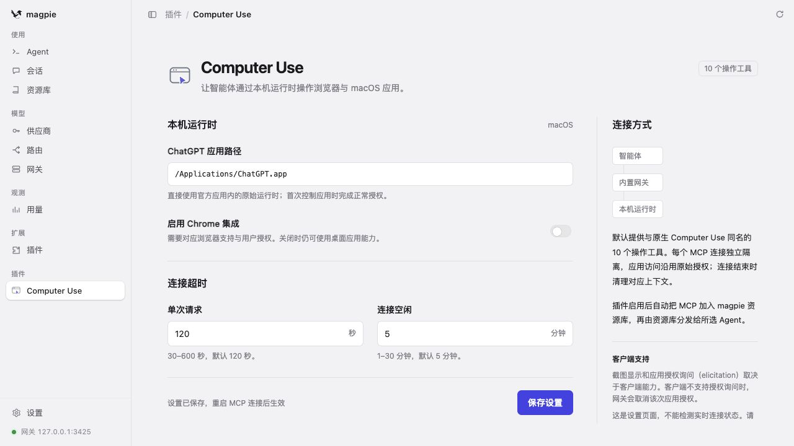
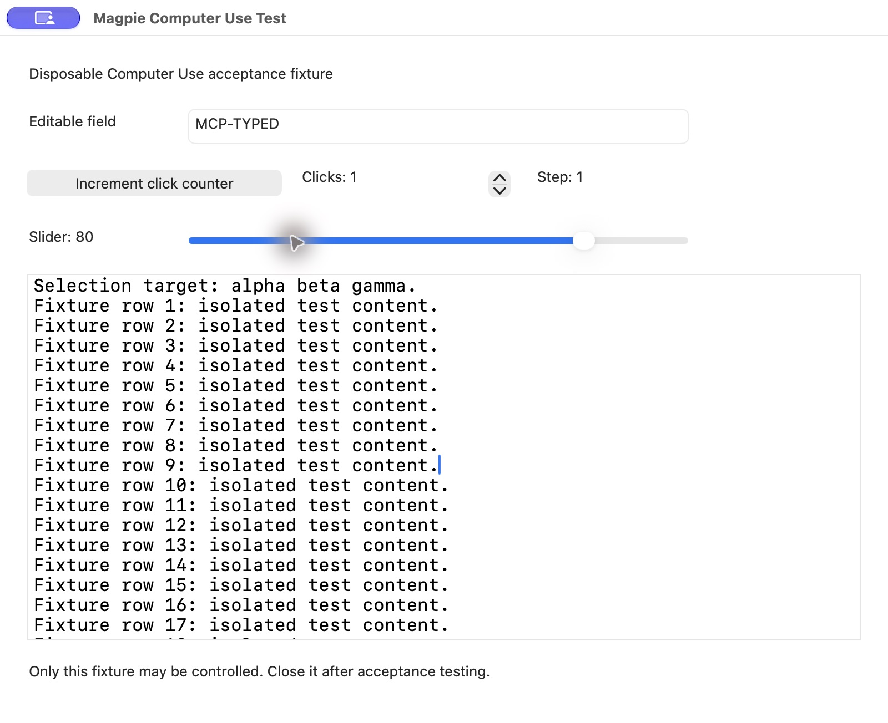

# 验证记录

文档核对日期：**2026-10-17（Asia/Shanghai）**；插件版本：**0.4.0（未发布）**。

magpie 扩展安装、资源库分发与 Claude Code 的十工具 GUI 调用已分别实测。本轮 GUI 共 28 次调用，覆盖十种工具，`isError` 均为 `false`；`scroll` 确实移动内容，但存在方向表现限制，不能将本轮结果概括为所有参数和场景均已通过。

## magpie 扩展与资源库

使用真实 magpie **0.1.1272** 验证：

- 在隔离 profile 的“扩展”界面添加本地项目，插件加载后自动创建 `magpie-computer-use` MCP；新条目的 `agents` 为 `[]`，没有自动启用全部 Agent。
- 资源库检测成功并列出十个操作工具。用户现有条目已通过界面迁移到 magpie 管理的 Bun launcher 与 `--config` 私有选项快照，保留原来的 `claude` 选择。
- 设置页将单次请求从 120 秒改为 130 秒后，私有快照更新为 `130000`；检查后已通过界面恢复为 `120000`，Agent 选择仍保留。
- 此流程从 magpie“扩展”安装，不要求用户运行独立安装、注册或 MCP 配置导出命令。

下图为真实 magpie **设置页**，不是资源库工具列表截图：

## Claude Code 十工具 GUI 实测

最终 GUI 记录时间为 **2026-10-16T15:20:26.110Z**（北京时间 2026-10-16 23:20:26）。

| 环境项 | 本轮记录 |
| --- | --- |
| Claude Code | 2.1.301，使用本机已安装的可执行文件 |
| 启动宿主 | 官方 TypeScript Agent SDK 0.3.301 |
| 模型 | `workbuddy-ai/deepseek-v4.1-flash`，仅作本轮临时覆盖，未持久修改用户设置 |
| 工具限制 | `builtins: []`，严格 MCP 配置，仅提供本插件十个工具 |
| 目标 | 自有 AppKit 测试应用 `dev.magpie.computer-use-test`，只含合成数据 |
| 原始沙箱 | 保留，没有关闭原始 node_repl 沙箱 |

默认 aihub 请求先前返回 502，本轮改用用户已配置的上述模型完成工具验收；这不证明所有模型都支持相同图片或工具行为。从受限外层环境嵌套启动时曾受 `sandbox-exec` 限制；随后通过正常宿主授权在该外层限制之外启动复测，没有关闭原始运行时沙箱。

### 授权处理

用户已明确允许控制 **Magpie Computer Use Test**。原始应用授权询问仍然产生；本轮后续对同一 fixture 的请求，由测试 harness 严格匹配目标应用及授权 schema 后转回该用户的同一选择。这是限定本轮、限定目标的测试回答复用，**不是“没有授权询问”或“零自动回答”**。

测试 harness 不属于生产自动批准逻辑。生产插件仍转交原始授权请求，缺少 elicitation 能力或用户未回答时取消；不会据此批准其他应用，也不会允许控制 Agent 宿主。

普通无交互 `claude -p` 先前无法完成该授权，出现过 `Computer Use was not approved to use Magpie Computer Use Test`。这属于授权交互限制，不能替代本轮已授权测试的结论。

### 每个工具观察到的结果

| 工具 | 真实结果 |
| --- | --- |
| `list_apps` | 返回原生应用列表，并发现指定测试应用；不发布完整应用清单 |
| `get_app_state` | 返回目标界面树及 MCP image block，多次读取成功 |
| `click` | 计数按钮从 `Clicks: 0` 变为 `Clicks: 1`，并能定位输入框 |
| `set_value` | 测试输入框变为 `MCP-SET` |
| `press_key` | `super+a` 选中 `MCP-SET`，另一次 `Return` 调用无工具错误 |
| `type_text` | 输入框由所选文字变为 `MCP-TYPED` |
| `select_text` | 在测试文字中选中 `beta` |
| `perform_secondary_action` | 界面提供的 `Increment` 使 `Step: 0` 变为 `Step: 1`；另验证了界面提供的滚动辅助操作 |
| `drag` | 滑块从 20 移至约 80.47；界面标签显示为 `Slider: 80` |
| `scroll` | 确认内容和滚动条发生位移，方向表现见下节 |

下图是上述自有测试窗口的真实结果截图；其中内容为合成测试数据：

### 已知限制：滚动方向

测试中，`up` / `down` 的表现与按文档内容上、下位置理解的直觉方向相反：

- 从滚动条值 0 开始，`up`、`pages: 2` 返回约 `0.844295`，随后读取到 `1`。
- 再执行 `down`、`pages: 2`，滚动条回到约 `0.127517`。
- 再执行 `down`、`pages: 1`，回到 `0`。

因此只确认本环境下滚动调用会移动内容，**不确认方向语义符合通常的内容导航预期**。根因尚未查明，没有证据将其归因于系统“自然滚动”设置；也未验证其他应用、水平滚动或全部 `pages` 取值。使用时先小幅滚动并重新读取界面，不盲目连续重放方向。

机器摘要见 [claude-code-verification.json](claude-code-verification.json)。可复现测试窗口源码为 `scripts/fixtures/GuiFixture.swift`，开发用法见 [贡献指南](../CONTRIBUTING.md)。完整清单、提示词、原始模型/授权日志及临时 SDK 脚本不纳入仓库。

## 实测中修复的问题与自动化检查

真实原始 REPL 在每个 cell 会重新初始化该 cell 中声明的 `var`。旧包装反复声明共享 Map，可能清空前一次 `get_app_state` 保存的目标，导致后续操作找不到应用。

现实现按 session、turn、app 的哈希生成目标绑定，只有 `get_app_state` 声明该绑定，其他操作直接引用。回归 fixture 显式模拟原始 REPL 的声明重置行为，避免只在普通 JavaScript 环境中测试而漏掉该问题。

最终复核为 **31/31 项单元测试通过、26 个模块语法/入口检查通过、8 项设置页检查通过**。覆盖工具参数和编码、跨调用目标保留、上下文隔离、图片/进度转发、用户授权/缺失能力取消、超时/退出清理，以及自动登记、选项快照、已有 Agent 选择保护和同名冲突。自动化检查不替代上面的真实 GUI 结果。

`npm pack --dry-run --ignore-scripts` 成功，包清单为 **45 个文件**，不包含官方二进制。测试窗口脚本另做两次清理验收：编译期间取消后退出码为 0、临时目录为 0；通过 LaunchServices 打开窗口后按 Ctrl+C，同样退出码为 0、临时目录为 0。这些检查不等于 npm 或 GitHub 已发布。

## 原始运行时版本边界

文档核对时，本机安装元数据为 ChatGPT **26.1013.31256**、CUA **0.0.30/20261014203459-0849368674e2**（`darwin-arm64`）。GUI 原始记录未可靠标注当时的应用/运行时版本，因此不将这组元数据或旧文档中的版本冒充为 GUI 当时版本。

当前安装的只读 smoke 已于 **2026-10-17T02:48:24.439Z** 通过；只读调用结果见 [verification.json](verification.json)，当前安装元数据另记于 [Claude Code 验证摘要](claude-code-verification.json)；调用路径保留官方签名校验。只读 smoke 仅验证真实 MCP 工具列表和 `list_apps`，不执行目标 GUI 控制；它与 Claude Code GUI 摘要分开保存。

## 清理与未测范围

先前已删除旧 `.runtime`（约 42 MB）、`work`（约 160 MB）以及旧开发暂存/克隆和打包验证副本（约 42 MB）。本轮还清理了约 170 MB 的临时 SDK 源码、编译缓存、原始测试日志、隔离 profile，以及两份开发暂存目录；测试窗口和临时服务均已退出。仓库只保留脱敏摘要与两张已核对的截图。项目直接使用本机官方应用，没有复制的 OpenAI 二进制或外部 LCU 安装；开发依赖 `node_modules` 不随发布包分发。

本轮仅控制自有 AppKit 测试应用。未验证 Chrome、每款 Agent、每个模型、每类控件、全部工具参数或每种 macOS 权限状态。图片结果已真实返回，不等同于所有模型都能理解图片。插件仍未发布、未进入官方精选；功能测试不代表发布或收录已完成。
